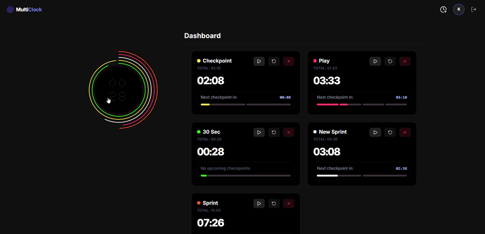
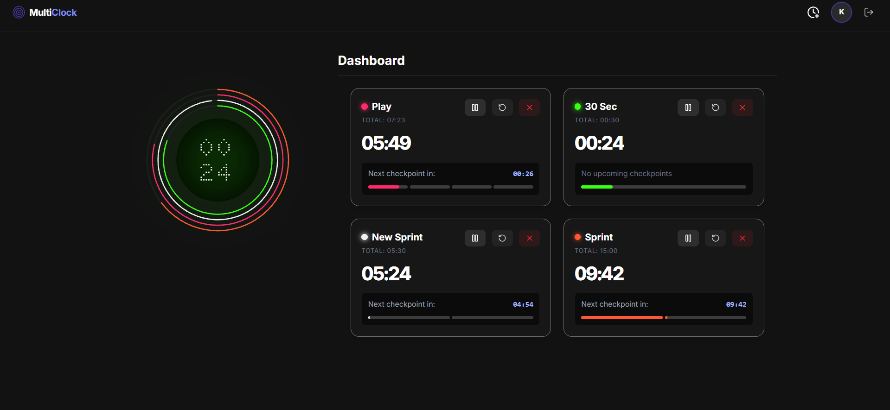
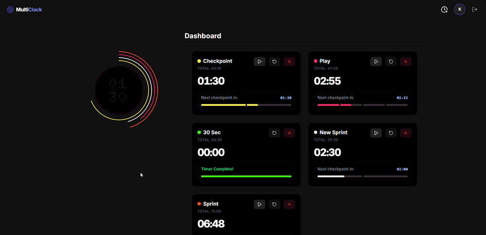
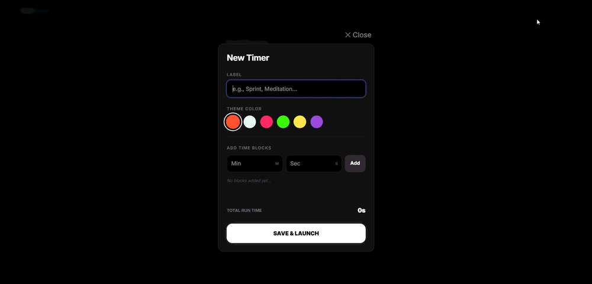
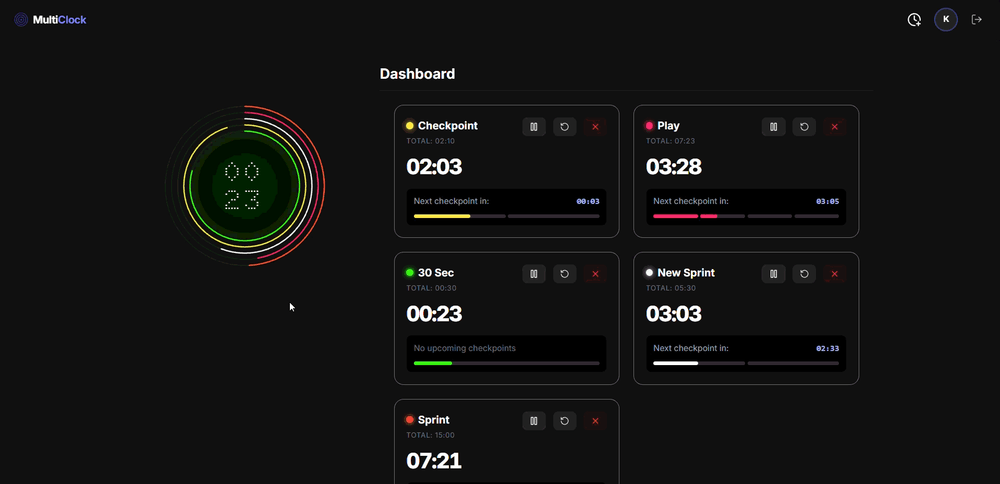
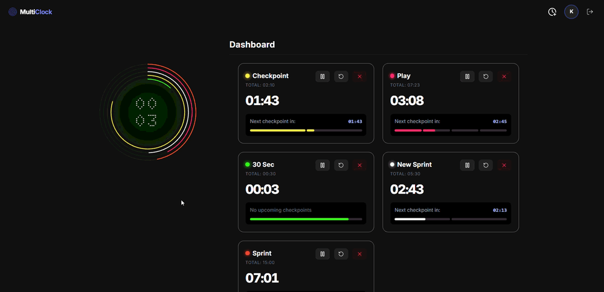

<h1 align="center">MultiClock ⏳</h1>

<p align="center">
  <strong>Master Your Time.</strong><br>
  <em>The multi-timer app that lets you bifurcate time like a pro.</em>
</p>

<p align="center">
  
  
  
  
  
</p>

<p align="center">
  
</p>

---

## About

MultiClock tracks several independent countdown timers at once. Each timer can be split into
time blocks ("bifurcated"), with an alarm at every checkpoint, and every timer is drawn as a
glowing ring on a single orbital clock.

<p align="center">
  
</p>

## Features

### 🪐 Orbital clock with a master control
Each timer is a concentric ring that drains in real time. The "black hole" center shows
whichever timer finishes next; tap it to play or pause every timer at once (shown at the top).
Each card also has its own play, reset and delete controls.

<p align="center">
  
</p>

### ➕ Build timers from time blocks
Name a timer, pick its ring color, and stack up as many blocks as you need. The total runtime
updates as you go, and colors already in use are locked out.

<p align="center">
  
</p>

### 🔔 Checkpoint alarms
At the end of every block, an alarm plays and a toast announces the next block, while the
block's progress bar fills in.

<p align="center">
  
</p>

### ✅ Completion that waits for you
When a timer finishes, the alarm keeps ringing until you acknowledge it, so it can't be missed.

<p align="center">
  
</p>

### Under the hood
- **Drift-free timing:** countdowns are computed from wall-clock deadlines, so throttled background tabs stay accurate.
- **Custom authentication:** email/password accounts with no third-party auth provider (see [below](#how-authentication-works)).

## Tech stack

| Layer      | Choice                                                   |
| ---------- | -------------------------------------------------------- |
| Framework  | Next.js 16 (App Router, Server Actions, Route Handlers) |
| Language   | TypeScript                                               |
| Styling    | Tailwind CSS v4                                          |
| Database   | Cloud Firestore (via `firebase-admin`)                  |
| Validation | Zod, with schemas shared by client and server           |
| Auth       | Custom: `bcryptjs` + `jose` signed session cookies       |

## How authentication works

1. **Sign up / log in** are Server Actions (`src/app/actions/auth.ts`). Input is validated with Zod.
   Passwords are hashed with bcrypt (12 rounds) and never leave the server.
2. **Unique emails** are enforced atomically: a `userEmails/{sha256(email)}` lock document is
   created in the same Firestore transaction as the user.
3. **Sessions** are HS256-signed JWTs (`jose`) stored in an `httpOnly`, `sameSite=lax` cookie
   (`secure` in production) that expires after 7 days. The token holds only the user id.
4. **Two layers of checks:**
   - `src/proxy.ts` makes *optimistic* redirects: signed-out visitors go to `/login`, and signed-in ones skip the landing page.
   - Every API route and the dashboard re-verify the session server-side (`src/lib/session.ts`).
     Timer deletes also check ownership, and return `404` for timers that belong to someone else.
5. **No user enumeration:** login returns the same error for an unknown email and a wrong password, and
   compares against a dummy hash, so both cases take the same time.
6. **Rate limiting:** login is capped at 5 attempts per email and 20 per IP every 15 minutes, and
   signup at 5 per IP per hour. Counters live in Firestore (`rateLimits`, keyed by a hash), so the
   limits hold across serverless instances.

## Tests

```bash
npm test
```

Vitest covers the parts that are easy to get subtly wrong:

- **Sessions:** round-trips, tampered payloads, foreign secrets, `alg: none`, expiry, short secrets.
- **Countdown math:** accuracy after long gaps between ticks (a throttled tab) and checkpoints that fire exactly once.
- **Rate limiting:** window counting, retry-after, window reset.
- **Validation:** the Zod schemas the client and API share.

## API

| Method   | Route              | Description                                      |
| -------- | ------------------ | ------------------------------------------------ |
| `GET`    | `/api/timers`      | The signed-in user's timers, newest first        |
| `POST`   | `/api/timers`      | Create a timer `{ label, intervals[], color? }`  |
| `DELETE` | `/api/timers/:id`  | Delete one of your timers                        |

`duration` is always computed on the server from `intervals`. Each user can have up to 6 timers,
one per ring color.

## Project structure

```
src/
├─ app/
│  ├─ (auth)/login, (auth)/signup   # auth pages
│  ├─ dashboard/                    # the app (session read streams in via Suspense)
│  ├─ actions/auth.ts               # signup / login / logout server actions
│  └─ api/timers/                   # REST route handlers
├─ components/                      # Clock, TimerCard, Dashboard, AddTimerForm, ...
├─ lib/
│  ├─ firebase.ts                   # lazy firebase-admin init
│  ├─ session.ts, session-token.ts  # cookie + JWT handling
│  ├─ timers.ts, auth-schemas.ts    # Zod schemas, shared types, helpers
│  └─ alarms.ts                     # checkpoint / completion sounds
└─ proxy.ts                         # optimistic route protection
```

## Getting started

```bash
npm install
cp .env.example .env.local   # then fill in the values
npm run dev
```

Environment variables:

| Name                    | Description                                                     |
| ----------------------- | --------------------------------------------------------------- |
| `FIREBASE_PROJECT_ID`   | From your Firebase service account                              |
| `FIREBASE_CLIENT_EMAIL` | From your Firebase service account                              |
| `FIREBASE_PRIVATE_KEY`  | Service account key, with `\n` escapes, wrapped in quotes       |
| `SESSION_SECRET`        | Random string of 32+ characters used to sign session cookies    |

Firestore needs one composite index, on `timers`: `userId` ascending + `createdAt` descending.
The first query prints a link that creates it. Optionally, add a TTL policy on `rateLimits.expiresAt`
so expired rate-limit counters are deleted automatically.
